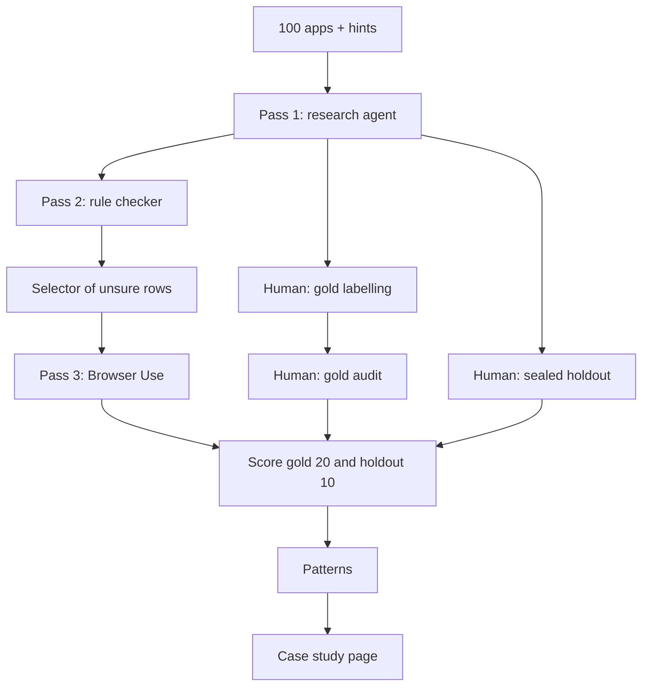

# composio-app-research

Research whether 100 apps can become agent toolkits: auth, how a developer gets access, API surface, existing MCP, whether Composio already covers the app, and a buildability verdict. Then cluster the patterns and show how accuracy was verified.

This is a take-home style research pipeline, not a production product.

## Repo layout

- `data/apps.csv` — the 100-app research set (id, slug, category, starting hint/URL)
- `data/composio_toolkits.json` — cached Composio catalog snapshot
- `data/composio_aliases.json` — manual slug map for product names the automatic matcher would get wrong
- `data/composio_coverage.csv` — which of the 100 already have a Composio toolkit
- `scripts/composio_coverage.py` — refresh the catalog and rebuild the coverage table
- `schema/` — what one researched row looks like, how fields are defined, and how accuracy is scored
  - `app_row.schema.json` — machine-readable row shape
  - `README.md` — field and enum definitions
  - `RUBRIC.md` — scoring rules and gold-sample procedure
  - `gold_sample.md` / `gold_sample.jsonl` — 20 apps reserved for the headline accuracy check (hand-labelled, audited, and locked)
  - `HOLDOUT.md` / `holdout_sample.jsonl` — 10 sealed apps, labelled once, used only as a generalisation check
  - `GOLD_AUDIT.md` — what changed in the gold audit and the rubric clarifications
- `agent/` — research agent CLI (`python -m agent run`): `llm/` provider adapters, `tools/` search/fetch providers, `research.py` loop, `validate.py` schema + consistency + evidence checks, `prompts.py`; pass-2 reviewer (`python -m agent review`): `review.py` loop, `review_rules.py` rule checklist; pass-3 browser check (`python -m agent browse`): `browse_flags.py` selector, `browse.py` loop
- `tests/` — offline unit tests (LLM and tools mocked)
- `data/runs/<run_id>/` — agent outputs
- `.agents/skills/composio/` — Composio skill used when building the research agent

## Status

Main is at `a4abbd7`: schema, research agent, pass-1 run on all 100 apps, audited gold labels, sealed holdout labels, and the pass-2 reviewer plus its run. This branch adds pass 3, a Browser Use check of the 45 unsure rows (133 pages in local Chromium and 23 pages on Browser Use Cloud across 17 sessions; 31 confirmed, 14 changed, 55 unflagged copied through). Gold row accuracy moved 9/20 (45%) -> 16/20 (80%) -> 15/20 (75%) (one preview-verdict regression in pass 3), and the sealed holdout stayed 3/10 across all three passes. Patterns, the human-check items, and the case-study page come next.

## How the system works

The system is a pipeline of loops, not a single run. A research agent fills all 100 rows, a rule checker reviews them, a selector picks the unsure ones, and a browser pass opens those pages like a person would. Humans write and lock the answer keys. Scoring compares each pass to those keys.



### Pass 1 · research agent

Searches official docs, fills one schema row per app, and quotes the sentence behind each claim. This is the untouched baseline. It already includes validators, a gap-fill fetch of leftover official MCP or API-auth pages, and thin-page fallbacks.

What it fixes, relative to a naive search-and-summarise loop: evidence URLs have to be pages the run actually fetched, quoted snippets have to appear in the page text, and consistency rules catch mistakes such as listing `sdk_only` next to a raw HTTP API.

How to run it:

```bash
.venv/bin/python -m agent run --run-id pass1 --concurrency 3 --max-pages 8
```

Reuse `--run-id` to resume. Output lives in `data/runs/pass1/`. See [Run](#run) for the full options.

### Pass 2 · rule checker

Rechecks every pass-1 row against a fixed list of general rules (for example: HTTP Basic used only to send a key is not its own login method; a preview or waitlist is not `buildable_now`). Code fires a rule only when the row's notes or a vendor-page quote clearly show the pattern. One LLM reviewer call per row can name more of the same rules, but it never edits the row. Only the fields behind a fired rule are re-researched. Every other field stays byte-identical.

What it fixes: the general habits that showed up in pass 1, without a full redo of all 100 apps. The first live pass changed 31 of 100 rows and left 69 unchanged. Gold row accuracy moved from 9/20 to 16/20. The four remaining gold misses were already wrong in pass 1 and no rule fired on them.

How to run it:

```bash
.venv/bin/python -m agent review --from-run pass1 --run-id pass2 --concurrency 3
```

See [Review (pass 2)](#review-pass-2) for flags and output.

### Selector of unsure rows

After pass 2, a code selector flags rows that still look shaky: confidence is not high, evidence is thin or unsupported, or a deciding fact (access, MCP live vs coming soon, auth) sits on a page that did not load properly. Only those rows go to the browser. The reason ids are `confidence_not_high`, `unsupported_or_invalid` (the pass-2 log or evidence checks show unsupported evidence or validation errors), `thin_or_blocked_page` (a page cited for access, auth, MCP or verdict came back thin, blocked or failed), and `unresolved_deciding_fact` (notes or quotes mention book-a-demo / talk-to-sales, a coming-soon or beta MCP or API, or an unreadable JS-only page). Every reason that applies is recorded in `flags.jsonl`.

### Pass 3 · Browser Use

The open-source Browser Use library opens and renders each page (pricing, signup, auth and MCP) in a real Chromium browser (local first; Browser Use Cloud browsers only for blocked, captcha, or empty pages) and saves a screenshot. Our Bedrock model then reads the rendered page and decides, confirming or fixing only the in-scope fields with quotes — it does not click or navigate inside the page. This is for facts that a plain HTTP fetch often misses: JavaScript docs, pricing tables, signup walls, and "coming soon" banners.

Browser Use (open source) + Browser Use Cloud browsers for blocked pages. Each flagged row opens up to 4 pages (pages flagged as thin or blocked first, then pricing/signup, auth docs and MCP pages it already cites, plus `start_url`, `docs_url` and `mcp_url`; login walls are skipped). The open-source Browser Use library opens and renders each page in a local headless Chromium browser first (no clicking or navigating inside the page). Only a page that comes back empty, shows a captcha, or is blocked is retried on a Browser Use Cloud browser. That needs `BROWSER_USE_API_KEY` in the environment. Without it the fallback is skipped and logged as `cloud_skipped_no_key`. A row starts at most one cloud session, and only on its first fallback. Each page is logged with `browser: local | cloud`, the fallback reason, text length and screenshot path. The Bedrock model (or configured `LLM_PROVIDER`) reads the rendered page and decides, not the Browser Use cloud model. It gets one call per row (plus one retry) and may confirm or correct only the in-scope fields, with quotes that must be found in the rendered text. If the rendered pages cannot support a value, the pass-2 values are kept with a note. Composio's Browser Use toolkit was not used: a read-only probe found no active connection for it in this project, the same "No active connection" problem as the other Instant toolkits.

See [Browse (pass 3)](#browse-pass-3) for the commands, flag reasons and output.

### Human checks

A person is the referee, not someone who re-reads all 100 rows.

- **Gold labelling.** 20 apps, two per category, were labelled by hand from official docs without looking at the agent rows.
- **Gold audit.** Every gold field was rechecked against official docs. Three labels were corrected, the rubric was clarified, and the set was locked. The score is only as good as this key, so it has to be 100% correct.
- **Sealed holdout.** 10 fresh apps, none from the pilot or the gold 20, were labelled and locked before the pass-2 rules were written. That set is scored once per frozen pass, and no further rule is written to chase the number.

### Scoring

`scripts/score_gold.py` compares a run to a locked answer file. The headline is **row accuracy**: a row counts only if every critical field is right (auth, access, API, MCP, verdict, blocker) and the evidence supports them. Per-field percentages are also reported, because a strict row score can hide that most fields were already right.

```bash
.venv/bin/python scripts/score_gold.py --run-dir data/runs/pass1 --gold schema/gold_sample.jsonl
.venv/bin/python scripts/score_gold.py --run-dir data/runs/pass2 --gold schema/gold_sample.jsonl
.venv/bin/python scripts/score_gold.py --run-dir data/runs/pass3 --gold schema/gold_sample.jsonl
.venv/bin/python scripts/score_gold.py --run-dir data/runs/pass2 --gold schema/holdout_sample.jsonl --out-dir data/scores/holdout
```

Current locked scores (`data/scores/`):

| Set | Pass 1 | Pass 2 | Pass 3 |
|---|---|---|---|
| Gold 20 (headline) | 9/20 (45%) | 16/20 (80%) | 15/20 (75%) |
| Sealed holdout 10 | 3/10 (30%) | 3/10 (30%) | 3/10 (30%) |

The 80% gold score is measured on the set that informed some of the checker rules (the audit, not the original writing of the labels). The sealed 10 is the cleaner generalisation test, and it did not move in pass 2.

### Honest limits

The checker only catches patterns it was written for, which is why a rule such as `official_graphql_omitted` can exist and still never fire. A browser pass helps when the deciding fact renders on one of the target URLs, even behind JavaScript or a block page. Because it is page-reading only (no clicking or navigating agent), it cannot follow links, open tabs, or expand accordions to reach a fact on a page it did not directly open. It also will not fix every judgement call, such as which login method is the main one, or a product whose official MCP page never uses the word MCP in the URL or title. Composio Instant is still in the code, but it returns `400 No active connection found`, so search and fetch use the direct Exa API with free tools as fallback. `EXA_BUDGET_USD=0` disables Exa rather than lifting the cap; use a high positive number to leave it uncapped in practice.

Patterns, the deployed case-study page, and a final README polish still come after pass 3 is scored.

## How we improved accuracy

The headline score will be pass-1 vs final accuracy on the 20 gold apps in `schema/gold_sample.md`. Those 20 are left untouched until the final check, so we do not tune rules to the score we will report.

To find general failure modes first, we ran a 10-app pilot: one app per category, none of them in the gold 20. The rows are in `data/runs/pilot-10/` (with a hand review). The misses clustered into a few patterns, not one-off product bugs:

- auth fields that contradicted the row's own notes (for example OAuth that only exists for an MCP server)
- `sdk_only` listed alongside a raw HTTP API type
- a paid signup treated as `self_serve_paid` even when the vendor also requires a manual review or a mandatory app-store listing
- a blank `start_url` causing search to land on a different product with a similar name
- an official MCP page on a sibling docs host being missed

We then added general validators and prompt/rubric rules for those patterns (see `agent/validate.py`, `agent/prompts.py`, and `schema/RUBRIC.md`) and reran the **same** 10 apps as a regression check (`data/runs/pilot-10b/`). Row-correct accuracy on that holdout went from 3/10 to 8/10. The gold 20 were not used in that loop.

The same 10 were rerun once more after switching search and fetch to the direct Exa API (`data/runs/pilot-10c/`). Row-correct accuracy stayed 8/10: the blank-URL product-identity miss was fixed, a notes-vs-auth-methods contradiction reappeared on one row, and an MCP server whose official pages appeared in search results was still not fetched. The gold 20 were not used in that loop either.

That last miss is a general retrieval gap, so the agent now fetches up to 3 leftover vendor-owned search results that look like MCP or API-auth/OAuth docs before it settles the row, even when the page cap is already full, and re-asks the LLM once only if they returned text. The same 10 were rerun again as `data/runs/pilot-10d/`; row-correct accuracy moved from 8/10 to 9/10. The leftover official API-auth docs were read this time. One MCP miss remains, where the official MCP-style pages either did not use the word MCP in the URL or title, lived on a sibling host the vendor-name check did not treat as owned, or were crowded out by other official-domain MCP pages about a different product line. The gold 20 were not used in that loop either.

For pass 2 we added a reviewer step (`python -m agent review`) instead of rerunning the whole agent. It reads each pass-1 row and checks it against a fixed list of general rules with stable ids. The rules are: `basic_transport_not_method`, `oauth_client_secret_not_api_key`, `mcp_only_oauth`, `sales_or_review_gate`, `preview_not_buildable_now`, `official_graphql_omitted`, `public_docs_marked_false`, `missed_vendor_mcp`, `unsupported_evidence`, plus the existing validators. Code fires a rule only when the row's own notes or a vendor-page quote clearly show the pattern. One LLM reviewer call per row catches the rest, but it only names rules and never edits the row. Only the fields behind a fired rule are re-researched and rewritten. Every other field stays byte-identical, and a fix that official pages cannot support is dropped in favour of the pass-1 value, with a note. These rules came from the failure patterns above and the scoring rubric, not from any one app. The first live pass over all 100 is in `data/runs/pass2/`. It changed 31 rows and left 69 unchanged. On the locked gold 20, row accuracy moved from 9/20 (45%) in pass 1 to 16/20 (80%) in pass 2 (`data/scores/pass2.md`). The four remaining gold misses were already wrong in pass 1 and the reviewer did not fire on them: an official GraphQL API left off `api_types`, a vendor app-review gate still labelled self-serve, a vendor-published MCP page still missed, and a self-serve personal-token path labelled as a partner gate.

## Refresh Composio coverage

Needs a `COMPOSIO_API_KEY` (already in `.env.example`). From the repo root:

```bash
python -m venv .venv
source .venv/bin/activate
pip install -r requirements.txt
set -a && . /path/to/local.env && set +a
python scripts/composio_coverage.py --refresh
```

Without `--refresh`, the script reuses `data/composio_toolkits.json` and only rebuilds the coverage table. It never prints secret values.

## Run the research agent

For each app in `data/apps.csv` the agent runs a few targeted web searches (API auth, access/pricing, API reference, MCP server), drops results that don't look like the app (it keeps the official domain, doc/code hosts that name the app, and at most 2 third-party pages that name it), fetches up to `--max-pages` pages (always including `start_url`, official domain first), and asks an LLM to fill the row **from the fetched page text only**. The LLM may ask for one follow-up round (max 3 searches / 3 extra pages). Then:

- Every evidence URL is checked against the pages actually fetched in that run. Unfetched URLs are dropped and logged in `checks`.
- Each claim's quoted snippet is checked against the page text.
- The row is validated against `schema/app_row.schema.json` and the consistency rules in `schema/README.md`. If it fails, the errors go back to the LLM for one retry. If it still fails, the row goes to `failures.jsonl` and the run continues.
- `composio_toolkit` is copied from `data/composio_coverage.csv`. The LLM never researches it.

### Install

```bash
python -m venv .venv && .venv/bin/pip install -r requirements.txt
.venv/bin/pip install -r requirements-dev.txt   # tests + ruff
```

`requirements.txt` installs `boto3` for the default Bedrock provider. For another provider, install its SDK too: `anthropic`, `openai`, or `google-genai`.

### Configure

```bash
cp .env.example .env   # then fill in one LLM provider
```

| `LLM_PROVIDER` | Needs | Default `LLM_MODEL` |
|---|---|---|
| `bedrock` (default) | `AWS_ACCESS_KEY_ID`, `AWS_SECRET_ACCESS_KEY` (or `AWS_PROFILE`), `AWS_REGION` (default `ap-south-1`) | `global.anthropic.claude-sonnet-5-5` |
| `anthropic` | `ANTHROPIC_API_KEY` | `claude-sonnet-5-5` |
| `openai` | `OPENAI_API_KEY` | `gpt-5.1` |
| `gemini` | `GEMINI_API_KEY` | `gemini-2.5-pro` |

`LLM_MODEL` overrides the default for any provider. Set `LLM_PRICE_IN_PER_MTOK` / `LLM_PRICE_OUT_PER_MTOK` to get `est_cost_usd` in the log. Variables already in the shell win over `.env`. Use `ENV_FILE=/path/to/file` to load a different file. Secrets are never printed or logged.

### Run

```bash
.venv/bin/python -m agent run --dry-run --apps hubspot          # offline: fake LLM + fake tools, no keys
.venv/bin/python -m agent run --apps hubspot,firecrawl --run-id smoke
.venv/bin/python -m agent run --limit 10 --concurrency 3 --max-pages 8 --run-id pass1
.venv/bin/python -m agent run --run-id pass1                    # resume: skips apps already in rows.jsonl
```

Output goes to `data/runs/<run_id>/`:

- `rows.jsonl`: one schema-valid row per app
- `failures.jsonl`: rows that stayed invalid after the retry, with their errors, plus crashes
- `evidence/<slug>.json`: searches run, fetched pages (requested and final URL, status, fetched_at, sha256, text_len, extraction `method`), a quoted snippet per claim, and `checks` (dropped evidence, unverified snippets, unfetched docs/MCP URLs, warnings, validation errors)
- `log.jsonl`: per app wall time, search/fetch/LLM call counts, tokens, est. LLM cost, Exa / Instant spend, and which providers served each call
- `cache/`: raw fetched text, plus `<slug>.llm.json` with every raw LLM response per attempt (text, stop reason, usage). Gitignored.

Pages that extract to under ~1500 chars (typical for JS-rendered docs) go through fallbacks: trafilatura with favor_recall, then the page's `.md` twin, then plain visible text. For a thin docs page, `<origin>/llms.txt` is also fetched once per app. A truncated LLM answer (`LLM_MAX_TOKENS`, default 8000) gets one retry asking for a compact row.

Failed apps are not written to `rows.jsonl`, so re-running the same `--run-id` retries them.

### Review (pass 2)

```bash
# offline check: make a tiny dry-run input, then review it (both folders are gitignored)
.venv/bin/python -m agent run --dry-run --limit 1 --run-id dry-run-pass1
.venv/bin/python -m agent review --dry-run --from-run dry-run-pass1 --run-id dry-run-review --limit 1
# real pass 2 over every row of data/runs/pass1 (reuse --run-id to resume)
.venv/bin/python -m agent review --from-run pass1 --run-id pass2 --concurrency 3
```

`--from-dir PATH` reads any folder with a `rows.jsonl`. `--apps`, `--limit`, `--concurrency`, `--out-dir` and `--dry-run` work as they do for `run`. `--max-pages` (default 6) caps the pages fetched per re-researched row; gap-fill and llms.txt still apply on top of that, as in `run`. Search, fetch, Exa / Instant budgets and the free fallbacks are the same as `run`. The output folder has the usual `rows.jsonl`, `failures.jsonl`, `log.jsonl` and `evidence/<slug>.json` (pass-1 pages plus the review's pages, and a `review` block), plus `review.jsonl`. Each line in `review.jsonl` covers one row: status (`unchanged` / `confirmed` / `changed` / `kept` / `failed`), `rules_fired` with each finding's source (`code` / `llm` / `validator`), reason and quotes, the fields in scope, `fields_changed` with before and after values, whether re-research ran, and per-row search / fetch / LLM / Exa / Instant usage and wall time. If `cache/` from the input run is still present, the LLM reviewer also sees the pass-1 text of the cited pages.

### Browse (pass 3)

```bash
# offline check: fake browser + fake LLM, no Chrome or keys (dry-run folders are gitignored)
.venv/bin/python -m agent browse --dry-run --from-run pass2 --run-id dry-run-browse --limit 1
# real pass 3 over every row of data/runs/pass2 (reuse --run-id to resume)
.venv/bin/python -m agent browse --from-run pass2 --run-id pass3 --concurrency 1
```

Browser Use (open source) + Browser Use Cloud browsers for blocked pages. A code selector (`agent/browse_flags.py`) flags pass-2 rows that are still unsure, with reason ids `confidence_not_high`, `unsupported_or_invalid` (the pass-2 log or evidence checks show unsupported evidence or validation errors), `thin_or_blocked_page` (a page cited for access, auth, MCP or verdict came back thin, blocked or failed), and `unresolved_deciding_fact` (notes or quotes mention book-a-demo / talk-to-sales, a coming-soon or beta MCP or API, or an unreadable JS-only page). Each flagged row opens up to 4 pages (pages flagged as thin or blocked first, then the pricing/signup, auth and MCP pages it cites, plus `start_url`, `docs_url` and `mcp_url`; login walls are skipped). The open-source Browser Use library opens and renders each page in a local headless Chromium browser first (no clicking or navigating inside the page). Only a page that comes back empty, shows a captcha, or is blocked is retried on a Browser Use Cloud browser. That needs `BROWSER_USE_API_KEY` in the environment. Without it the fallback is skipped and logged as `cloud_skipped_no_key`. A row starts at most one cloud session, and only on its first fallback. The Bedrock model (or configured `LLM_PROVIDER`) reads the rendered page and decides, not the Browser Use cloud model. It gets one call per row (plus one retry) and may confirm or correct only the in-scope fields (access, auth, MCP, verdict/blocker, confidence and their evidence), with quotes that must be found in the rendered text. If the rendered pages cannot support a value, the pass-2 values are kept with a note. Composio's Browser Use toolkit was not used: a read-only probe found no active connection for it in this project, the same "No active connection" problem as the other Instant toolkits. Unflagged rows are copied to `rows.jsonl` unchanged (`flagged: false` in `flags.jsonl` and `browse.jsonl`; the row itself has no extra keys). `browse.jsonl` has one line per row: flag reasons, pages opened (url, `browser: local | cloud`, why the fallback happened, text length, title, screenshot path), fields confirmed vs changed (before/after), cloud sessions, LLM usage and wall time, and status (`copied` / `confirmed` / `changed` / `kept` / `failed`). Screenshots are saved to `screenshots/<slug>/` in the run folder, and the evidence notes and snippets point at them. `--concurrency` defaults to 1 because browsers are heavy.

### Search and fetch providers

With `EXA_API_KEY` set, the agent searches and reads pages through the [Exa API](https://exa.ai) directly, with free `ddgs` / `http` as the fallback. Without the key it uses the free tools only. Composio Instant is still in the code, but it is off unless you opt in:

| Variable | Default | Values |
|---|---|---|
| `SEARCH_PROVIDER` | `exa` with `EXA_API_KEY`, else `ddgs` | `exa` (Exa `/search`, ddgs fallback); `ddgs` (free only); `hybrid` (ddgs, then Composio Exa only when ddgs returns 0 results); `auto` / `composio_exa` / `composio_tavily` (Composio first, ddgs fallback). `USE_COMPOSIO_EXA=true` is the same as `auto`. |
| `FETCH_PROVIDER` | `exa` with `EXA_API_KEY`, else `hybrid` | `exa` (Exa text, http fallback); `hybrid` (http first; a URL goes to Composio `FIRECRAWL_SCRAPE` only when the page is still thin after all extraction fallbacks, or blocked: status 401/403/429/503 or a network error); `auto` / `composio_firecrawl` (Firecrawl first, http fallback); `http` (free only). |
| `EXA_BUDGET_USD` | `5` | Hard cap on Exa spend per run. `0` disables Exa calls. |
| `INSTANT_BUDGET_USD` | `0.30` | Hard cap on Composio Instant spend per run. `0` disables Instant calls. |

**Why Exa is called directly:** Composio Instant returned `400 No active connection found for toolkit(s) ...` for the `exa` and `firecrawl` toolkits, even with Instant enabled for the org. So the agent calls Exa with its own `EXA_API_KEY`. The provider is switchable in `.env`.

How the `exa` provider works:

- Search and fetch share one Exa client and one in-memory text cache per run. `POST /search` (`type: auto`, 5 results) asks for each result's page text in the same call. When the agent later fetches one of those URLs, the cached text is used: no second request, no second charge (`method: exa_search`). Other URLs go through `POST /contents` (`method: exa_text`). A repeat fetch is `exa_cache`.
- Every Exa call first reserves its listed price ($0.007 per search, $0.001 per page of contents). Over `EXA_BUDGET_USD`, the call is skipped (logged once) and the free tool serves it. The `costDollars.total` Exa reports is recorded when present, otherwise the listed price. Both are estimates, not an invoice.
- A 401/402/403 (bad key, no credits), or 3 server/network errors in a row, switches Exa off for the rest of the run, logged once. A single server error, or a page Exa could not read or was blocked from, falls back to the free tool for that call only. Any other 4xx for a URL is returned as a failed page.
- `log.jsonl` (per app) and the end-of-run summary report `exa_calls`, `exa_calls_by_endpoint` (search / contents), `exa_cost_usd` (reported cost plus listed estimates) and `exa_listed_estimate_usd` (the part that came from listed prices). `est_cost_usd` is still the LLM token estimate.

Composio is only tried when `COMPOSIO_API_KEY` is set. The first `No active connection`, 400/401/403 or 410 error switches Composio off for the rest of the run, logged once, and the free result is kept.

Every Composio call first reserves its listed price: `FIRECRAWL_SCRAPE` $0.003, `EXA_SEARCH` $0.007, `TAVILY_SEARCH` $0.008, anything else $0.01. You can override these with `INSTANT_PRICES`. If a call would push spend past the cap, it is skipped (logged once) and the free result is used. Sessions are created with `instant={"return_instant_charge": True}`. When Composio reports `instant_charge.amount`, that is counted as actual spend; otherwise the listed price is counted as an estimate.

`log.jsonl` (per app) and the end-of-run summary report `instant_calls`, `instant_calls_by_tool`, `instant_est_cost_usd` and `instant_charged_usd`.

`ddgs` tries backends in the order set by `DDGS_BACKENDS` (default `yahoo,duckduckgo,bing,brave,google`). When this was written, only `yahoo` returned results from this machine.

**What Composio unlocks:** Exa, Tavily and Firecrawl run through a Composio session (`composio.sessions.create(...)` then `session.execute(...)`). In this project they currently fail with `400 No active connection found for toolkit(s) ...`. This is still true after Instant was toggled in the dashboard: `session.search` reports `instant_account: null`. That is why the default is the direct Exa API (above), with the free path as fallback.

Composio becomes usable once Instant Toolkits work for the project key (prepaid balance) or an Exa / Firecrawl key is connected. To opt in, set `FETCH_PROVIDER=hybrid` (escalates thin or blocked pages to Firecrawl, within `INSTANT_BUDGET_USD`) and `SEARCH_PROVIDER=hybrid` or `auto` for Composio Exa search. The old `composio_search` toolkit is retired (HTTP 410) and is not used.
