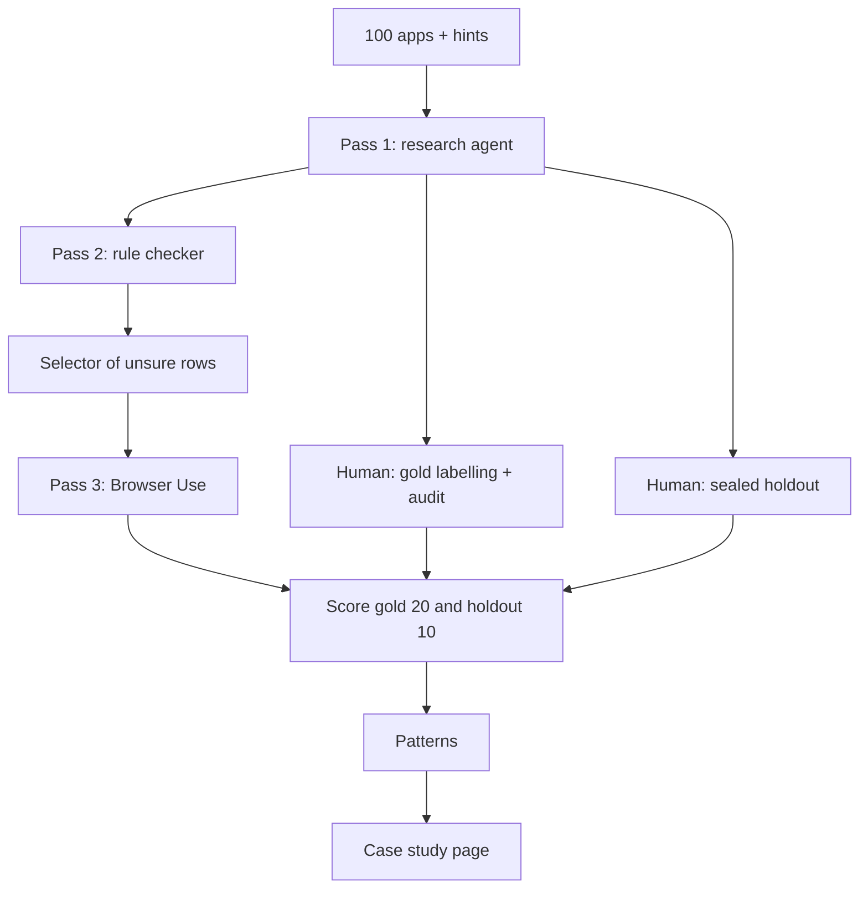

# composio-app-research

Can these 100 apps become agent toolkits? For each app an agent pipeline found the auth method, how a developer gets access, the API surface, any MCP server, whether Composio already covers it, and a buildability verdict. Every claim links to the page that proves it.

- **Case study page:** https://adithyaprad.github.io/composio-app-research/
- **Assignment brief:** [Notion](https://composio.notion.site/AI-Product-Ops-Intern-The-take-home-assignment-391f261a6dfe80e9946bee899d3a3762)
- **Final data:** `site/data/final.csv` / `final.json` (100 rows). Field definitions: `schema/README.md`.

## Results

- **84 of 100** are buildable now. **16** need vendor approval first (8 sales-gated, 8 partner-gated).
- **66** use OAuth2 as the main auth method, **32** an API key.
- **86** have an official MCP server.
- Composio has no toolkit yet for **22** apps. **11** of those can be built today (self-serve, public API, official MCP).
- **36** rows are flagged for a person to check (sales or partner gate, medium/low confidence, or conflicting docs).

Accuracy, scored as whole rows (a row counts only if auth, access, API, MCP, verdict and blocker are all right, with evidence):

| Answer key | Pass 1 | Pass 2 | Pass 3 |
|---|---|---|---|
| Gold, 20 apps | 9/20 (45%) | 16/20 (80%) | 15/20 (75%) |
| Sealed holdout, 10 apps | 3/10 (30%) | 3/10 (30%) | 3/10 (30%) |

Gold informed some of the checker rules, so the sealed holdout is the more honest number. A separate human spot-check of 10 random rows outside both sets confirmed 10/10 rows and 40/40 claims.

## How it works



1. **Pass 1: research agent** (`agent/research.py`). Searches official docs, fetches up to 8 pages, and asks an LLM to fill one schema row from the fetched text only. Evidence URLs must be pages it actually fetched, and quoted snippets must appear in that text. Rows are validated against `schema/app_row.schema.json` plus consistency rules, with one retry.
2. **Pass 2: rule checker** (`agent/review.py`, `agent/review_rules.py`). Checks every row against a fixed list of general rules (for example, a preview or waitlist is not `buildable_now`). Only fields behind a fired rule are re-researched; everything else stays byte-identical. It changed 31 of 100 rows.
3. **Selector** (`agent/browse_flags.py`). Flags rows that are still unsure: confidence below high, weak evidence, a deciding page that came back thin or blocked, or notes mentioning a demo, a sales call or a coming-soon MCP. 45 rows were flagged.
4. **Pass 3: Browser Use** (`agent/browse.py`). Renders up to 4 pages per flagged row in local headless Chromium (Browser Use Cloud only for blocked or captcha pages) and saves screenshots. The LLM then confirms or corrects only the in-scope fields, with quotes from the rendered text.
5. **Human checks** (`agent/human.py`). See below.

### Where a human was needed

1. **Gold labels.** 20 apps (two per category) labelled by hand from official docs, without looking at the agent's rows.
2. **Gold audit.** Every gold field re-checked against current docs. Three labels were corrected, then the set was locked (`schema/GOLD_AUDIT.md`).
3. **Sealed holdout.** 10 more apps labelled and locked before any pass-2 rule was written (`schema/HOLDOUT.md`).
4. **Needs-human flags.** 36 final rows flagged with reasons and evidence links (`data/runs/pass3/needs_human.json`). Every sales or partner gate is flagged on purpose: a bot cannot sit through a demo.
5. **Spot-check.** 10 random rows outside gold and holdout (fixed seed 42), every deciding claim opened and compared by hand (`data/runs/pass3/spot_check_10.md`).

### How accuracy was improved

Before touching the gold set, a 10-app pilot (one per category) surfaced general failure patterns: auth fields contradicting the row's own notes, `sdk_only` next to a REST API, paid signups that still need a manual review, blank start URLs landing on a same-named product, and MCP pages on sibling docs hosts. Fixing those as general rules moved the pilot from 3/10 to 9/10 over three reruns (`data/runs/pilot-10*`). Pass 2 then took gold from 9/20 to 16/20.

### Limits

- The checker only catches patterns it was written for.
- Pass 3 reads pages; it does not click, follow links or expand accordions.
- Some judgement calls (which login method is the main one) stay hard, which is why the holdout did not move.
- Composio Instant returned `400 No active connection found` for its Exa and Firecrawl toolkits in this project, so the agent calls the Exa API directly, with free search and fetch as the fallback.

## Run it

```bash
python -m venv .venv && .venv/bin/pip install -r requirements.txt -r requirements-dev.txt
cp .env.example .env   # fill in one LLM provider; EXA_API_KEY is optional
```

| `LLM_PROVIDER` | Needs | Default `LLM_MODEL` |
|---|---|---|
| `bedrock` (default) | AWS keys or `AWS_PROFILE`, `AWS_REGION` | `global.anthropic.claude-sonnet-5-5` |
| `anthropic` | `ANTHROPIC_API_KEY` | `claude-sonnet-5-5` |
| `openai` | `OPENAI_API_KEY` | `gpt-5.1` |
| `gemini` | `GEMINI_API_KEY` | `gemini-2.5-pro` |

Non-Bedrock providers need their SDK installed too (`anthropic`, `openai` or `google-genai`). Every option is documented in `.env.example`.

```bash
# offline, no keys: fake LLM, tools and browser
.venv/bin/python -m agent all --dry-run --limit 2 --run-id dry-run-all

# real end-to-end run: research -> review -> browse -> final export -> needs_human
.venv/bin/python -m agent all --input data/apps.csv --run-id full-run

# or one pass at a time (reuse --run-id to resume)
.venv/bin/python -m agent run    --run-id pass1 --concurrency 3 --max-pages 8
.venv/bin/python -m agent review --from-run pass1 --run-id pass2
.venv/bin/python -m agent browse --from-run pass2 --run-id pass3

# score a run against an answer key
.venv/bin/python scripts/score_gold.py --run-dir data/runs/pass3 --gold schema/gold_sample.jsonl
```

Each run writes to `data/runs/<run_id>/`: `rows.jsonl` (schema rows), `evidence/<slug>.json` (fetched pages and a quote per claim), `log.jsonl` (calls, tokens, cost) and `failures.jsonl`. `agent all` also writes `final.json`, `final.csv`, `needs_human.json` and `summary.json`. Any CSV with `id, slug, name, category, start_url` columns works as `--input`.

### Checks

```bash
.venv/bin/ruff check .
.venv/bin/pytest -q                              # offline, all external calls mocked
.venv/bin/python scripts/build_site.py           # rebuild site/ after any data change
.venv/bin/python scripts/build_site.py --check   # fail if site/ is stale
.venv/bin/python scripts/check_site.py           # recompute every number on the page
```

The case-study page is generated; never edit `site/` by hand. Pushing to `main` deploys it to GitHub Pages.

## Repo layout

| Path | What it is |
|---|---|
| `data/apps.csv` | the 100 apps (id, slug, category, start URL) |
| `data/composio_coverage.csv` | which apps Composio already covers (`scripts/composio_coverage.py`) |
| `schema/` | row schema, field definitions, scoring rubric, gold and holdout answer keys |
| `agent/` | the pipeline CLI (`python -m agent run / review / browse / all`) |
| `data/runs/` | every run's output: `pilot-10*`, `pass1`, `pass2`, `pass3` |
| `data/scores/`, `data/patterns/` | accuracy per pass, and the patterns analysis |
| `scripts/` | scoring, patterns, coverage and site build/check scripts |
| `site/` | the generated case-study page and its downloadable data |
| `tests/` | offline unit tests |
